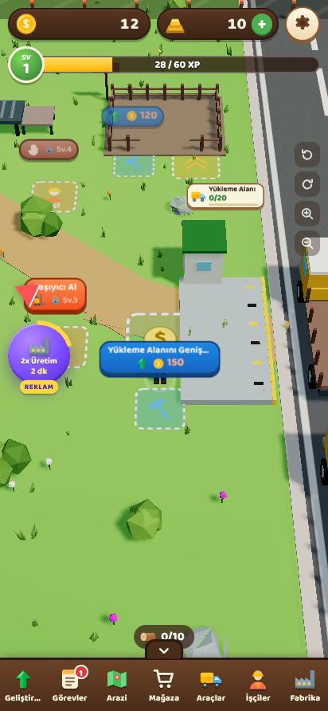

# 🌲 WOOD EMPIRE

**3D orman, kereste fabrikası ve işletme geliştirme simülasyonu — Android**

Küçük bir ormanla başla: ağaç kes, kütükleri sırtında taşı, testerede keresteye çevir, kamyonlarla sat. Kazandığınla makineleri yükselt, işçi ve forklift al, konveyör hatları kur, yeni araziler aç ve sonsuza kadar büyüyen bir kereste imparatorluğu kur.



## Özellikler
- **Tam 3B dünya** — izometrik takip kamerası (döndürme + zoom), gölgeler, rüzgarda sallanan ağaçlar, göletler, dağlar, yol, prosedürel low-poly modeller
- **Karakter** — dinamik joystick, yürüme/koşma/kesme/taşıma animasyonları, sırtta görsel istif, 5 yükseltme
- **5 ağaç türü** — çam, huş, meşe, sedir, parlayan Altın Ceviz; devrilme animasyonu, kütüğe ayrılma, kök ve yeniden büyüme
- **7 makinelik üretim zinciri** — testere (çoklu bıçak), zımpara, paketleme, palet, panel, mobilya, otomatik hat; her makinede hız/kapasite/kalite/boyut yükseltmesi
- **Otomasyon** — 3 rollü işçiler (oduncu, taşıyıcı, yükleyici) ve çalışma alanı atama, gerçek ürün taşıyan konveyörler, forkliftler
- **Lojistik** — görünür kamyon kuyruğu, 4 kamyon kademesi (20/50/100/200), 2 rampa, ürün deposu, satış geçmişi
- **Sonsuz ilerleme** — 10 tasarlanmış bölge + prosedürel sonsuz bölgeler, sınırsız seviye, sonsuz görevler ve başarılar
- **Geri dönüş sistemleri** — 7 günlük giriş ödülü, günlük görevler, çevrimdışı kazanç
- **Ticari** — AdMob ödüllü reklam, Google Play Billing + sunucu doğrulaması (bkz. [MONETIZATION.md](docs/MONETIZATION.md))
- **Güvenli kayıt** — çift yuva + sağlama toplamı, otomatik kayıt, arka plana geçişte kayıt
- **Özgün sesler ve müzik** — tamamı kodla sentezlendi (`scripts/gen-audio.mjs`)

## Hızlı başlangıç
```bash
npm ci
npm run dev        # tarayıcıda oyna (WASD + Q/E)
```
Android: [docs/BUILD.md](docs/BUILD.md) — GitHub'a push edince **APK + AAB otomatik üretilir** (`.github/workflows/android.yml`).

## Proje yapısı
```
src/
  config/     balance.js (tüm ekonomi), zones.js (harita), monetization.js
  core/       Game döngüsü, Input, CameraRig, EventBus, Buffer, State
  systems/    PlayerController, TreeSystem, WoodCollection, Inventory, Storage, Production,
              FactoryUpgrade, Conveyor, Worker, Vehicle, TruckLoading, Economy, Level, Mission,
              LandExpansion, Construction, DailyReward, Save, Shop, Ads, Billing, Audio
  world/      prosedürel 3B modeller, malzemeler, dokular, efektler, dünya kurucu
  ui/         HUD, menüler, dünya etiketleri, ikonlar, stil
public/audio/ ses efektleri + müzik
android/      Capacitor Android projesi
server/       satın alma doğrulama sunucusu
tests/        uçtan uca oynanış testi, sistem testi, ekonomi simülasyonu
docs/         mimari, tasarım, derleme, gelir modeli, test raporu, ekran görüntüleri
store/        Play Store simgesi ve öne çıkan görsel
```

## Test durumu
- Bölüm 30 uçtan uca oynanış testi: **16/16 başarılı** (gerçek dokunma/joystick girdisi, headless Chromium)
- Sistem entegrasyon testi: **21/21 başarılı**
- Ekonomi simülasyonu: 14 saatlik ilerleme eğrisi
- Gerçek Android cihaz, AdMob ve Play Billing testi **yapılmadı** — ayrıntı: [TEST_REPORT.md](docs/TEST_REPORT.md)

## Belgeler
- [Test Raporu](docs/TEST_REPORT.md)
- [Mimari](docs/ARCHITECTURE.md)
- [Oyun Tasarımı](docs/GAME_DESIGN.md)
- [Derleme ve Kurulum](docs/BUILD.md)
- [Reklam ve Satın Alma](docs/MONETIZATION.md)

## Yayından önce yapılması gerekenler
1. AdMob test kimliklerini kendi kimliklerinizle değiştirin.
2. Doğrulama sunucusunu yayınlayıp `IAP.verifyUrl` girin; Play dahili test kanalında satın almayı doğrulayın.
3. Yükleme anahtarını GitHub Secrets'a ekleyin (imzalı AAB).
4. Gerçek Android cihazlarda (düşük/orta/üst segment) performans ve dokunmatik testi yapın.
5. Gizlilik politikası URL'si ve Play Console veri güvenliği formunu doldurun (AdMob reklam kimliği kullanır).


## Yasal belgeler
- Gizlilik Politikası: https://feritbycn.github.io/woodempire/privacy.html
- Kullanım Şartları: https://feritbycn.github.io/woodempire/terms.html
- Verilerimi sil: https://feritbycn.github.io/woodempire/delete-data.html
- Sayfaların kaynağı `docs/site/` klasöründe; `main` dalına her gönderimde `.github/workflows/pages.yml` ile GitHub Pages'e yayınlanır.
- Play Console'da doldurulacak bilgiler (Veri güvenliği formu, reklam kimliği, app-ads.txt): [docs/PLAY_STORE.md](docs/PLAY_STORE.md)
